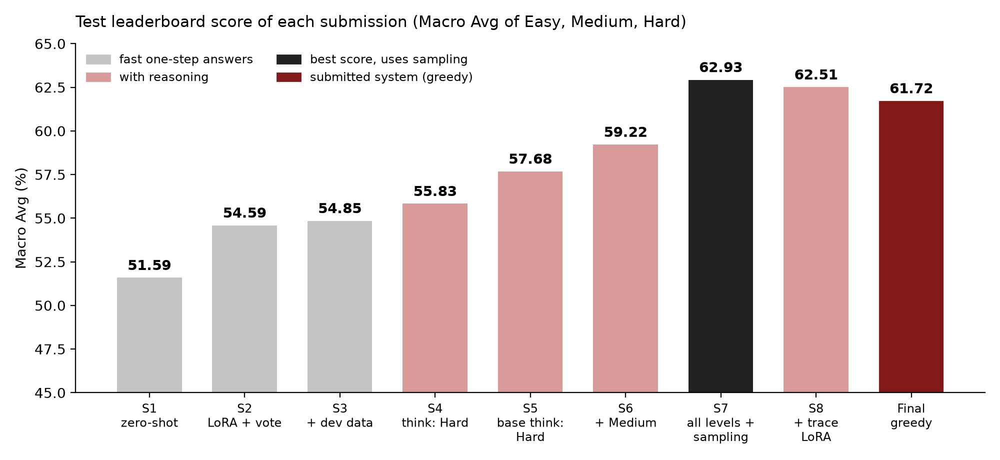

# SinhalaMMLU shared task (≤ 8B)

[](LICENSE)
[](https://huggingface.co/SinhalaMMLU-SharedTask/team-nexus)

**Code and experiments behind Team Nexus's 3rd-place entry in the ICTer 2026 SinhalaMMLU Shared Task.**

System for the ICTer 2026 SinhalaMMLU shared task: Sinhala multiple-choice QA with open-weight models totalling
≤ 8B parameters, no retrieval, no internet at inference. Built on SinhalaMMLU (Pramodya et al., EMNLP 2025):

```bibtex
@inproceedings{pramodya-etal-2025-sinhalammlu,
  title     = "{S}inhala{MMLU}: A Comprehensive Benchmark for Evaluating Multitask Language Understanding in {S}inhala",
  author    = "Pramodya, Ashmari and Nelki, Nirasha and Shalinda, Heshan and Liyanage, Chamila and Sakai, Yusuke and
               Pushpananda, Randil and Weerasinghe, Ruvan and Kamigaito, Hidetaka and Watanabe, Taro",
  booktitle = "Proceedings of the 2025 Conference on Empirical Methods in Natural Language Processing",
  year      = "2025",
  pages     = "32931--32949",
  url       = "https://aclanthology.org/2025.emnlp-main.1673/"
}
```

## Result

**Team Nexus placed 3rd on the hidden test set of the SinhalaMMLU Shared Task (ICTer 2026).** The submitted system is the
base model `google/gemma-4-E4B-it` with its vision and audio towers removed (7.463B parameters, weights unchanged),
prompted zero-shot with Gemma 4's built-in thinking mode and **greedy decoding** (no sampling, no fine-tuning, no extra data).

Public Codabench leaderboard scores (provisional, before the hidden-test ranking):

| Easy | Medium | Hard | Macro Avg |
|---:|---:|---:|---:|
| 63.55 | 54.19 | 67.42 | **61.72** |

The submitted configuration is `configs/submission_base_think_greedy.yaml`.
The development work in this repository also covers LoRA and full fine-tuning, continued pre-training, distillation,
reasoning-trace tuning and self-consistency; none of them beat the base model with thinking on held-out data.

## How the score improved

Every step below was a Codabench submission, scored on the public test leaderboard (provisional, Macro Avg of Easy, Medium
and Hard). Each row builds on an earlier row.

| Step | What changed | Easy | Medium | Hard | Macro |
|---|---|---:|---:|---:|---:|
| S1 | Zero-shot Gemma 4 E4B, one-step answer | – | – | – | 51.59 |
| S2 | LoRA on Global-MMLU `si` + voting over 4 option orders | 55.30 | 49.51 | 58.97 | 54.59 |
| S3 | + all SinhalaMMLU dev questions in training | 54.83 | 50.77 | 58.97 | 54.85 |
| S4 | + thinking mode on Hard | 55.30 | 49.51 | 62.68 | 55.83 |
| S5 | Base model (no adapter) does the thinking on Hard | 55.14 | 49.87 | 68.04 | 57.68 |
| S6 | + thinking on Medium | 55.14 | 54.91 | 67.63 | 59.22 |
| S7 | Base model only, thinking on all levels, + sampled self-consistency | 63.40 | 55.09 | 70.31 | 62.93 |
| S8 | S7 with Medium from a reasoning-trace LoRA | 63.40 | ≈53.8 | 70.31 | 62.51 |
| **Final** | **Base model only, greedy thinking on all levels (no sampling)** | **63.55** | **54.19** | **67.42** | **61.72** |



*Test leaderboard Macro Avg of each submission (provisional). The vertical axis starts at 45%.*

What moved the score:

- **Thinking mode is the main gain.** From S2 to the final system, Hard goes from 58.97 to 67.42, Easy from 55.30 to 63.55
  and Medium from 49.51 to 54.19, with no training at all.
- **Fine-tuning stopped helping once the model could reason.** An adapter trained to answer immediately made the model
  skip its reasoning (it reasoned on 26% of academic questions, against 100% for the base model), so the final system
  drops the adapter (S4 to S5: Hard +5.4).
- **Sampled voting was worth about 1.2 points** (S7 against Final, mostly on Hard), but the task asks for deterministic
  inference with no sampling, so the submitted system is the greedy one. The sampling variant is still in the code behind
  `SELF_CONSISTENCY = True` in the Hugging Face package.
- S8's Medium score is derived from its Macro Avg; S1's per-level scores were not recorded.

| Resource | Link |
|---|---|
| Reproducibility package (`inference.py`, `predictions.jsonl`, code) | https://huggingface.co/SinhalaMMLU-SharedTask/team-nexus |
| Text-only Gemma 4 E4B-it weights | https://huggingface.co/SinhalaMMLU-SharedTask/team-nexus-gemma-4-e4b-it-text |

**Task data is never committed** (`data/` is git-ignored). The SinhalaMMLU data is licensed CC BY-NC-ND 4.0; fetch it
yourself with `scripts/fetch_data.py`.

## Layout

| Path | Contents |
|---|---|
| `data/` | Git-ignored. `raw/` downloads, `processed/` normalised JSONL |
| `eval/` | Evaluation harness (`run_eval.py`, scorers, metrics, `summarize.py`) |
| `train/` | Fine-tuning / continued-pretraining code |
| `inference/` | Final offline submission pipeline |
| `configs/` | Candidate models, fixed data splits |
| `scripts/` | Data building, parameter counting, overlap checks, synthetic MCQ generation |
| `scripts/runs/` | The exact experiment queues behind every reported result and submission (see its README) |
| `run_submission.sh` | One-command offline reproduction of a submission |
| `reports/` | Aggregate results tables (no task data) |
| `MODEL_MANIFEST.md` | Every model: exact total parameters, release date, license |
| `DATA_LOG.md` | Every dataset and every closed-API data-generation use |

## Setup

```bash
python3 -m venv .venv
.venv/bin/pip install torch --index-url https://download.pytorch.org/whl/cu130
.venv/bin/pip install -r requirements.lock.txt
echo "hf_token = hf_..." > .env && chmod 600 .env   # read token; accept gated terms for SinhalaMMLU, Gemma 3/3n, Llama
```

Triton (used by `torch.compile`, Liger Kernel and flash-linear-attention) compiles helpers against `Python.h`.
If `python3.12-dev` is installed, nothing else is needed. Without sudo, unpack the headers locally; the code
(`eval/common.py: ensure_python_headers`) then adds them to `CPATH` automatically:

```bash
mkdir -p ~/.local/pydev && cd ~/.local/pydev
V=3.12.3-1ubuntu0.17   # any 3.12.3 Ubuntu build; the machine's apt index may list a version no longer on the mirror
for p in libpython3.12-dev python3.12-dev; do
  curl -fO "http://ports.ubuntu.com/ubuntu-ports/pool/main/p/python3.12/${p}_${V}_arm64.deb"; done
for f in *.deb; do dpkg -x "$f" root; done
```

## Commands

```bash
.venv/bin/python scripts/fetch_data.py            # SinhalaMMLU dev, Global-MMLU si, Belebele si -> data/raw
.venv/bin/python scripts/prepare_data.py          # -> data/processed/*.jsonl (fixed splits in configs/splits)
.venv/bin/python scripts/count_params.py          # exact parameter counts -> MODEL_MANIFEST.md
scripts/runs/run_baselines.sh                     # zero-shot baselines -> results/, reports/
./run_submission.sh [config]                      # reproduce a submission offline -> results/submissions/final.zip

# One model, any setting
.venv/bin/python -m eval.run_eval --model google/gemma-4-E4B-it --data sinhalammlu_dev gmmlu_si_val \
    --method logit --n-perms 4 --lang en --run-name my_run
```

### Harness options

- `--method logit` (next-token probability over labels 1-4), `generate` (greedy decode + parse), `cloze`
  (length-normalised option likelihood).
- `--n-perms K --perm-mode cyclic|random`: score each question under K option orders. Reports original-order
  accuracy, permutation-vote accuracy, spread across orders, consistency, and position-bias tables.
- `--lang en|si` instruction language; `--chat auto|on|off`; `--fewshot-file F --n-shot N` (the same fixed
  examples for every question, as the rules require).
- Breakdowns by dataset, domain, subject, grade and (Global-MMLU) cultural sensitivity, with Wilson 95% CIs.
- Every run stores the exact model commit, library versions, git commit and the full argument set in `metrics.json`.
- `--write-submission` writes a Codabench-format `predictions.zip` (`predictions.jsonl` with
  `q_no, subject, category, level, answer`).

## Rules checklist

- Total parameters of everything loaded at inference ≤ 8B (embeddings, vision/audio towers if loaded, adapters).
- Open-weight models released before 2026-10-01 only. No API, internet or retrieval of any kind at inference.
- Fixed few-shot examples only (identical for every question). No training, tuning or prompt design on test questions.
- No closed or paid APIs were used at any stage (see `DATA_LOG.md`).
- Final pipeline runs offline from one command with pinned versions and fixed seeds.

## Contributors

Team Nexus, Department of Computer Science and Engineering, University of Moratuwa:

- S.A. Talagala
- Anas Hussaindeen
- Ifadha Imthiyas
- V.D.W. Muthumala

## Citation

If you use this code, please cite it with [`CITATION.cff`](CITATION.cff) and cite the SinhalaMMLU paper above.

## License

The code in this repository is released under the [Apache License 2.0](LICENSE). Datasets and models keep their own
licences: SinhalaMMLU is CC BY-NC-ND 4.0, and Gemma 4, Global-MMLU, FineWeb-2, NSINA and the other resources listed in
`DATA_LOG.md` and `MODEL_MANIFEST.md` are under the terms given there.
